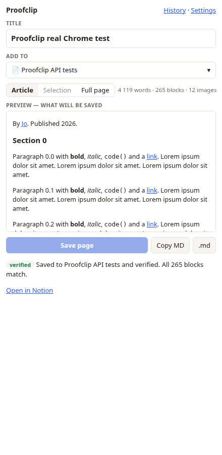

# Proofclip

**Save web pages to Notion. Check what arrived.**

A free, open-source Chrome extension. Preview your clip, edit its properties,
and save it to a Notion page or database. Proofclip then reads the saved blocks
back from Notion and compares their types and text, including nested blocks.



## Why Proofclip?

- **Preview before saving.** See the blocks that will be sent to Notion.
- **Choose your content.** Clip the article, your selection, or the full page.
- **Organize in the popup.** Edit supported properties and tags, search destinations,
  or create a new links database.
- **Keep a local copy.** Failed uploads stay in History and can retry automatically.
- **Check the result.** See a verified result or a mismatch message after saving.
- **Take your content with you.** Copy or download Markdown, or back up clips as JSON.
- **Connect multiple workspaces.** Each connection remembers its last destination.

## Install

The Chrome Web Store release is being prepared. You can load the extension now:

1. Download this repository and extract it, or clone it with Git.
2. Open `chrome://extensions` and turn on **Developer mode**.
3. Click **Load unpacked** and select the `extension/` directory.
4. Open Proofclip **Settings** and connect with a Notion integration token.

Create an internal connection at [Notion's developer portal](https://www.notion.so/profile/integrations)
with **Read content**, **Insert content**, and **Update content** permissions.
Share only the pages or databases you want the connection to access.

This release uses integration tokens. One-click **Sign in with Notion** requires
an OAuth deployment and is not configured in the distributed extension.

## How it works

1. Open a page and click Proofclip.
2. Choose Article, Selection, or Full page mode and inspect the preview.
3. Pick a Notion page or database. Edit the title and supported properties.
4. Click **Save page**. Proofclip stores a local copy, uploads it, and checks the saved blocks.
5. Click **Open in Notion** to view the result.

Verification compares block types and text, with whitespace normalization. It does
not confirm that external images remain available or compare all formatting and links.

## Privacy

Clips and connection details stay in your browser's local extension storage.
Content is sent directly to Notion when you save or retry. Preview images can load
from their source websites. There are no analytics or ads.

Read the [privacy policy](PRIVACY.md). Report problems in
[GitHub Issues](https://github.com/BranislavMateas/proofclip/issues).
Do not post API tokens or private content in an issue.

## Development and tests

```sh
npm install
npm test        # 27 unit/integration tests against a strict mock Notion API
npm run e2e     # real extension in Chrome, tested against the mock API
npm run real    # live Notion API; requires NOTION_TOKEN and NOTION_PAGE_ID
npm run package # build dist/proofclip-0.2.0.zip from extension/ only
```

`npm run real` also reads a Git-ignored `.env.test` file. It moves the generated
Notion pages and database to trash after the test. Set `KEEP=1` to retain them.
Never put a token in tracked files or commit it to Git.

On October 22, 2026, all eight live API clips passed verification, including six
public websites. A separate Chrome run saved and verified a 265-block clip.

### Optional OAuth deployment

1. Create a public Notion integration with redirect URI `https://<extension-id>.chromiumapp.org/notion`.
2. Deploy `server/oauth-worker.js` with `NOTION_CLIENT_ID` and `NOTION_CLIENT_SECRET` secrets.
3. Set `ALLOWED_ORIGIN=chrome-extension://<extension-id>` on the worker.
4. Add the public client ID and worker URL to `extension/config.js`.

The client secret belongs on the server. Never bundle it in the extension.

## Current limitations

- If Notion creates a page but its response is lost, a retry can create a duplicate page.
- The extension uses Notion API version `2022-06-28`. Multi-source databases are not supported.
- Safari and mobile share sheets are outside the current scope.

## Support the project

Bug reports, suggestions, and contributions are welcome. If Proofclip helps you,
share the repository, give it a star, or [buy me a coffee](https://buymeacoffee.com/braniq).

## License

[ISC](LICENSE). Bundled Mozilla Readability uses the [Apache 2.0 license](extension/vendor/LICENSE.md).
Proofclip is an independent project and is not affiliated with Notion.
